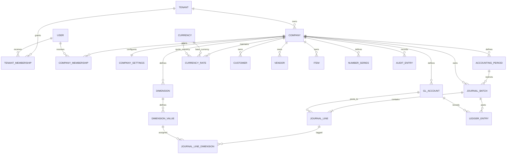

# Architecture overview

## Foundation

The application starts as a modular monolith. The web host owns the Blazor Server UI and composition root. Application contains use cases and interfaces; Domain contains business concepts and rules; Infrastructure implements database and external-service adapters. Dependencies point inward: Domain is independent, Application depends on Domain, Infrastructure implements Application abstractions, and Web composes the layers.

The initial solution uses .NET 10, an installed supported LTS SDK. Entity Framework Core and SQL Server are the intended persistence stack; no database provider, Identity configuration, or schema migration is wired yet.

## Proposed company and user boundary

Treat an ERP customer/tenant as the owner of one or more companies. Users are authenticated independently and receive explicit tenant/company memberships. Company-owned business records are scoped by company, and application services authorize access before reading or mutating them. This is a proposed logical boundary, not implemented or yet enforced by a database.

## Conceptual initial data model

The initial ER model has been implemented as EF Core entities and a SQL Server migration. See [the schema catalogue, constraints, and verification record](../schema/initial-schema.md). Identity storage and company-scoped membership constraints are in the migration, but Identity login/authorization wiring and tenant-aware query authorization remain Phase 1 work. Period-date validation, balanced posting transactions, posted-entry immutability, and reversal workflows are documented future application invariants, not yet implemented business behavior. Catalogue currencies are shared while exchange rates remain company-scoped.
