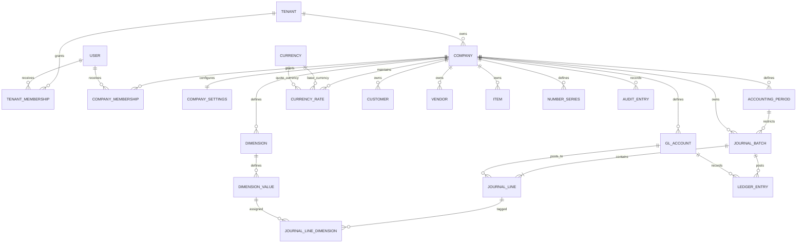

# Architecture overview

## Foundation

The application starts as a modular monolith. The web host owns the Blazor Server UI and composition root. Application contains use cases and interfaces; Domain contains business concepts and rules; Infrastructure implements database and external-service adapters. Dependencies point inward: Domain is independent, Application depends on Domain, Infrastructure implements Application abstractions, and Web composes the layers.

The initial solution uses .NET 10, an installed supported LTS SDK. Entity Framework Core and SQL Server are the intended persistence stack; no database provider, Identity configuration, or schema migration is wired yet.

## Proposed company and user boundary

Treat an ERP customer/tenant as the owner of one or more companies. Users are authenticated independently and receive explicit tenant/company memberships. Company-owned business records are scoped by company, and application services authorize access before reading or mutating them. This is a proposed logical boundary, not implemented or yet enforced by a database.

## Conceptual initial data model

The initial ER model has been implemented as EF Core entities and SQL Server migrations. See [the schema catalogue, constraints, and verification record](../schema/initial-schema.md). Identity login/logout, active-company context, and application-level tenant/company authorization are implemented. The generic Workspace notes example demonstrates SQL-backed company-scoped CRUD; its service, schema, data, and example component code remain, but its product navigation and routed CRUD pages are retired. Former note routes render an authorized unavailable notice without loading or modifying notes. Database row-level security is not implemented. Period-date validation, balanced posting transactions, posted-entry immutability, and reversal workflows are documented future application invariants, not yet implemented business behavior. Catalogue currencies are shared while exchange rates remain company-scoped.

## Company information and global shell

`CompanyInformation` is an optional one-to-one profile keyed by `CompanyId`, with a restrictive
company foreign key and an optimistic Guid version token. It stores core contact/address fields
and a bounded raster logo; the canonical name remains on `Company`. It is independent of
`CompanySettings`, so a company can maintain its profile before configuring a base currency.
The company-authorized service updates the name/profile and audit action in one EF save.

The layout owns the profile card and available-company panel. A shared client coordinator
layers all business dialogs below the global header, preserves background scroll, and places
loading above the entire application. Company changes still use the server-rendered account
endpoint and cookie claim rather than mutating company state inside an existing circuit.
The email-first sign-in UI retains the same Identity authentication and lockout boundary.
