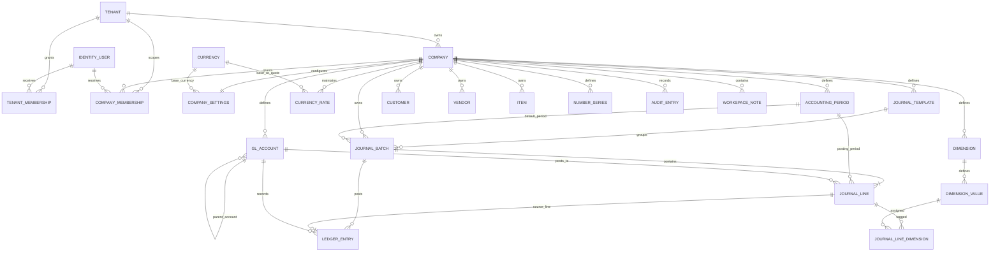

# Initial application-owned schema

**Status:** Application-owned schema, initially migrated locally and now aligned to selected Business Central 28.4 concepts after a limited, read-only review of AL metadata. It is not a field-for-field reproduction of Business Central.

## Scope and provenance

- Application schema source: this repository's C# domain entities and `ErpDbContext` configuration. All application code and schema decisions remain independently implemented.
- Migrations: `InitialCompanyAndFinancialSchema`, `AlignJournalAndAccountingFoundation`, and `AddWorkspaceNotes`.
- Target/provider: SQL Server via EF Core 10.
- Local smoke-test database: `BusinessCentralBlazor_Phase0` on the user's existing `.\BCDEMO` SQL Server Express instance. The migration was applied to this newly named database only; other databases were not modified.
- Reference artifact: W1 `28.4.53241.0`, paired by its manifest with platform `28.0.53152.0`; selected table metadata was read from the platform archive's Base Application source ZIP. The user confirmed permission to inspect the local artifact. The archive was read in memory and not modified; no source files, packages, license files, or demo data were copied into this repository.
- The model aligns selected ERP concepts and relationships, not every Business Central object, field, validation, or posting workflow.

## Catalogue

| Area | Tables | Ownership and primary constraints |
|---|---|---|
| Authentication | `AspNetUsers`, `AspNetRoles`, `AspNetUserClaims`, `AspNetUserLogins`, `AspNetUserRoles`, `AspNetUserTokens`, `AspNetRoleClaims` | ASP.NET Core Identity uses `Guid` IDs. Login/logout, active-company selection, and application-level authorization are wired into the web host; database row-level security is not implemented. |
| Tenant/company | `Tenants`, `Companies`, `CompanySettings`, `TenantMemberships`, `CompanyMemberships` | Company code is unique within a tenant. Memberships reference Identity users. Company membership has composite references to the company and tenant membership so a user cannot be linked to a company outside their tenant through these constraints. |
| Currency and periods | `Currencies`, `CurrencyRates`, `AccountingPeriods` | ISO-style 3-character currency key; minor units 0–4; company-scoped unique rate per base/quote/date, positive rate, date-bounded periods uniquely identified by company and start date, with separate closed and date-locked flags. |
| General ledger foundation | `GeneralLedgerAccounts`, `GeneralJournalTemplates`, `GeneralJournalBatches`, `GeneralJournalLines`, `GeneralLedgerEntries` | Accounts distinguish posting structure from financial category. Journals follow template → batch → line; each line has its own company-scoped period while a batch carries a default period. Composite FKs prevent cross-company account, template, batch, and period references. Journal/ledger amounts are `decimal(19,4)`; batches use row-version concurrency; a unique `(CompanyId, JournalLineId)` ledger index prevents duplicate posting. |
| Dimensions | `Dimensions`, `DimensionValues`, `JournalLineDimensions` | Dimension/value codes are unique in their company and dimension. Each line assignment has one value per dimension and composite same-company foreign keys. Dimension-set deduplication and reuse remain future work. |
| Operational master data | `Customers`, `Vendors`, `Items` | Company-scoped unique numbers; optional currency reference; item cost uses `decimal(19,4)` and cannot be negative. |
| Foundation UI example | `WorkspaceNotes` | Safe generic example records are explicitly tenant/company scoped, with a composite FK to prevent cross-tenant company references. Service operations revalidate the active company and filter reads and writes by the validated tenant/company pair. |
| Controls and audit | `NumberSeries`, `AuditEntries` | Number-series code unique per company, positive next number, bounded digit width, row-version concurrency; audit rows are company-scoped and indexed by occurrence time. |

The schema now defines 22 application-owned domain tables, 7 ASP.NET Core Identity tables, and the EF migration-history table (30 tables total after all migrations are applied). With the user's approval, `AddWorkspaceNotes` was applied to `BusinessCentralBlazor_Phase0` on `.\BCDEMO`. The migration-history row, `WorkspaceNotes` table, composite company FK, and index were verified; the table contains no seeded notes. Other databases require their own reviewed migration application.

## Relationships



The diagram omits Identity's internal claims/login/token relations for readability. Company-owned rows carry `CompanyId`; database composite keys protect cross-company references where a company-owned principal is referenced. Tenant/company data access still requires server-side authorization and company scoping in application services; it is not implemented by this migration alone.

## Financial and data invariants

- Monetary columns use fixed precision, never floating point. Local-currency journal/ledger debit and credit amounts are represented as nonnegative `decimal(19,4)` values; a database check requires exactly one side to be positive per line/entry.
- When a foreign currency is supplied, its currency debit or credit amount must also have exactly one positive side. Currency and exchange rates reference the currency catalogue; rate is positive and stored as `decimal(19,8)`.
- Each journal batch belongs to a company-scoped template and has a company-scoped default accounting period; each journal line references its own company-scoped period so one batch can contain lines in different periods. Every line also references the same company's batch and account. **Checking the posting date lies within the referenced period is a future application rule**, not a database check.
- Every ledger entry references the source journal batch, source line, and account in the same company. Unique source-line indexing provides database-level duplicate-posting protection.
- A posting service must, in a single database transaction, validate period/account/dimension/company rules, calculate and round amounts under the company's currency precision, verify batch debit equals credit in local currency, create ledger entries, and transition the batch to posted. Those posting services and rollback/concurrency behavior are not implemented in Phase 0.
- Posted ledger rows must be append-only from application services; reversal/correction creates new entries. Database permissions/immutability enforcement and reversal workflows are future work.
- `DateOnly` maps to SQL `date`; timestamps are `DateTimeOffset` and named `...Utc`. Services must normalize timestamps to UTC.
- `NumberSeries` and journal batches have SQL Server `rowversion` optimistic-concurrency tokens. Allocating numbers still requires a transaction/retry strategy.
- Audit metadata is optional JSON text; validation, redaction, retention, and tamper protection remain application/operations responsibilities.

## Intentional differences and omissions

- A tenant owns multiple companies; Identity users receive explicit tenant/company memberships. Roles are stored as membership role names, while global Identity roles are available as a separate foundation. Effective-permission semantics remain to be finalized with Phase 1 authorization.
- Currencies form a shared reference catalogue; company-specific conversion rates and accounting settings remain company-scoped.
- No automatic currency, account, customer, vendor, item, or workspace-note seeding is included.
- `WorkspaceNotes` is a small generic CRUD example, not an ERP business module; rows are company-owned and the UI creates them only after the user selects a valid active company.
- The selected metadata review informed the journal template/batch/line hierarchy, the distinction between account structure and financial category, and period start-date plus closed/date-locked concepts. Internal GUID keys, company-scoped tables, and the batch's default period are application choices.
- This is not a complete Business Central model: journal lines currently post only to G/L accounts; default/global dimensions are not modeled; dimension combinations are assigned directly rather than deduplicated into dimension sets; currency exchange-rate semantics, posting setup, posting groups, document types, and posting workflows are simplified or deferred.
- No sales/purchase documents, inventory movements/valuation, tax, bank reconciliation, document numbering policies, attachments, localization, or posting engine are implemented.

## Local migration workflow

Install the repository-local tool once with `dotnet tool restore`. Set a connection string in the current PowerShell process (never commit user credentials), then use:

```powershell
$env:ConnectionStrings__ErpDatabase = 'Server=.\BCDEMO;Database=BusinessCentralBlazor_Phase0;Trusted_Connection=True;TrustServerCertificate=True'
dotnet ef migrations list --project src\BusinessCentralBlazor.Infrastructure --startup-project src\BusinessCentralBlazor.Web
dotnet ef database update --project src\BusinessCentralBlazor.Infrastructure --startup-project src\BusinessCentralBlazor.Web
sqlcmd -S .\BCDEMO -E -d BusinessCentralBlazor_Phase0 -b -i database\scripts\verify-initial-schema.sql
```

The alignment migration preserves existing account categories and batch/period data, creates a default General journal template per company, and copies each batch's former period association to its journal lines while retaining it as the batch's default period. Its `Down` migration refuses to proceed if per-line periods diverge from the batch default or if duplicate names prevent restoration of the old unique keys; as with other schema downgrades, back up first because newly introduced template, description, date-lock, and account-type data has no representation in the old schema. The SQL smoke test requires the alignment migration, runs in a transaction, and rolls its test data back; it checks valid persistence, debit/credit checks, cross-company composite FKs, and duplicate-posting protection. Use only `BusinessCentralBlazor_Phase0` or a newly named development database for migration tests; never point these commands at an existing company or Business Central demo database. No hosted deployment is part of the current local-only workflow.

## Verification record

- Migration `20261012043920_InitialCompanyAndFinancialSchema` was generated and applied successfully to new local database `BusinessCentralBlazor_Phase0`.
- SQL Server inspection confirmed the database, migration-history row, expected Identity and application tables, foreign keys, check constraints, and unique indexes.
- `database/scripts/verify-initial-schema.sql` passed against the new database; valid records persisted within the transaction, the database rejected invalid zero-sided journal lines, cross-company journal references, and duplicate ledger posting, and the test rows were rolled back.
- Unit tests verify required table mappings, same-company account references, debit/credit checks, monetary precision, and row-version concurrency metadata.
- The user initially verified the pre-alignment `dev` schema. After the alignment PR merged, the user-local `BusinessCentralBlazor_Phase0` database was updated through `20261012051809_AlignJournalAndAccountingFoundation`; both migrations are listed as applied. The updated SQL smoke test passed all five checks, Release build succeeded with 0 warnings/errors, tests passed (6/6), EF reported no pending model changes, and the app returned HTTP 200 at `http://localhost:5211`. After release to `main`, restore, Release build, all 6 tests, migration history, EF drift, all five SQL smoke checks, and app startup were repeated successfully against the merged `main` code. This verifies the aligned local Phase 0 schema, not field-for-field or runtime compatibility with Business Central.
- Further transactional/integration tests and authorization tests remain before financial posting is implemented.
