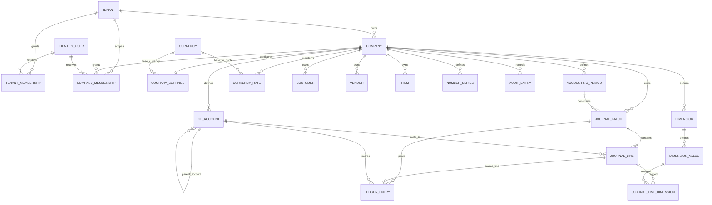

# Initial application-owned schema

**Status:** Draft baseline generated by `InitialCompanyAndFinancialSchema` and applied to a new local SQL Server development database. This schema is independently designed; no Business Central AL source, compiled package, license file, or demo data was read to create it.

## Scope and provenance

- Application schema source: this repository's C# domain entities and `ErpDbContext` configuration.
- Migration: `src/BusinessCentralBlazor.Infrastructure/Persistence/Migrations/InitialCompanyAndFinancialSchema`.
- Target/provider: SQL Server via EF Core 10.
- Local smoke-test database: `BusinessCentralBlazor_Phase0` on the user's existing `.\BCDEMO` SQL Server Express instance. The migration was applied to this newly named database only; other databases were not modified.
- The model covers common ERP foundation concepts, not a reproduction or exhaustive catalogue of Business Central objects.

## Catalogue

| Area | Tables | Ownership and primary constraints |
|---|---|---|
| Authentication | `AspNetUsers`, `AspNetRoles`, `AspNetUserClaims`, `AspNetUserLogins`, `AspNetUserRoles`, `AspNetUserTokens`, `AspNetRoleClaims` | ASP.NET Core Identity uses `Guid` IDs. Login/authorization services are not wired into the web host yet. |
| Tenant/company | `Tenants`, `Companies`, `CompanySettings`, `TenantMemberships`, `CompanyMemberships` | Company code is unique within a tenant. Memberships reference Identity users. Company membership has composite references to the company and tenant membership so a user cannot be linked to a company outside their tenant through these constraints. |
| Currency and periods | `Currencies`, `CurrencyRates`, `AccountingPeriods` | ISO-style 3-character currency key; minor units 0–4; company-scoped unique rate per base/quote/date, positive rate, date-bounded periods, company-scoped period code. |
| General ledger foundation | `GeneralLedgerAccounts`, `GeneralJournalBatches`, `GeneralJournalLines`, `GeneralLedgerEntries` | Company-scoped unique account and batch numbers; company-scoped composite FKs prevent cross-company account/batch/period/line references; journal/ledger amounts are `decimal(19,4)`; row-version concurrency on batches. A unique `(CompanyId, JournalLineId)` ledger index prevents a line being recorded twice. |
| Dimensions | `Dimensions`, `DimensionValues`, `JournalLineDimensions` | Dimension/value codes are unique in their company and dimension. The line assignment has one value per dimension and composite same-company foreign keys. |
| Operational master data | `Customers`, `Vendors`, `Items` | Company-scoped unique numbers; optional currency reference; item cost uses `decimal(19,4)` and cannot be negative. |
| Controls and audit | `NumberSeries`, `AuditEntries` | Number-series code unique per company, positive next number, bounded digit width, row-version concurrency; audit rows are company-scoped and indexed by occurrence time. |

The applied SQL schema contains 20 application-owned domain tables, 7 ASP.NET Core Identity tables, and the EF migration-history table (28 tables total), plus 45 foreign keys, 14 check constraints, and 208 unique indexes at the time of verification. The identity schema was created, but user authentication, role administration, and tenant/company authorization policies remain Phase 1 work.

## Relationships



The diagram omits Identity's internal claims/login/token relations for readability. Company-owned rows carry `CompanyId`; database composite keys protect cross-company references where a company-owned principal is referenced. Tenant/company data access still requires server-side authorization and company scoping in application services; it is not implemented by this migration alone.

## Financial and data invariants

- Monetary columns use fixed precision, never floating point. Local-currency journal/ledger debit and credit amounts are represented as nonnegative `decimal(19,4)` values; a database check requires exactly one side to be positive per line/entry.
- When a foreign currency is supplied, its currency debit or credit amount must also have exactly one positive side. Currency and exchange rates reference the currency catalogue; rate is positive and stored as `decimal(19,8)`.
- Each journal batch belongs to one company and accounting period. Every journal line references that same company's batch and account. **Checking the posting date lies within the referenced period is a future application rule**, not a database check.
- Every ledger entry references the source journal batch, source line, and account in the same company. Unique source-line indexing provides database-level duplicate-posting protection.
- A posting service must, in a single database transaction, validate period/account/dimension/company rules, calculate and round amounts under the company's currency precision, verify batch debit equals credit in local currency, create ledger entries, and transition the batch to posted. Those posting services and rollback/concurrency behavior are not implemented in Phase 0.
- Posted ledger rows must be append-only from application services; reversal/correction creates new entries. Database permissions/immutability enforcement and reversal workflows are future work.
- `DateOnly` maps to SQL `date`; timestamps are `DateTimeOffset` and named `...Utc`. Services must normalize timestamps to UTC.
- `NumberSeries` and journal batches have SQL Server `rowversion` optimistic-concurrency tokens. Allocating numbers still requires a transaction/retry strategy.
- Audit metadata is optional JSON text; validation, redaction, retention, and tamper protection remain application/operations responsibilities.

## Intentional differences and omissions

- A tenant owns multiple companies; Identity users receive explicit tenant/company memberships. Roles are stored as membership role names, while global Identity roles are available as a separate foundation. Effective-permission semantics remain to be finalized with Phase 1 authorization.
- Currencies form a shared reference catalogue; company-specific conversion rates and accounting settings remain company-scoped.
- No automatic currency, account, customer, vendor, item, or demo-data seeding is included.
- No sales/purchase documents, inventory movements/valuation, tax, bank reconciliation, document numbering policies, attachments, localization, or posting engine are implemented.
- No metadata was derived from Business Central. Later, if license and entitlement are verified, permitted reference metadata may inform a reviewed revision; it must not be copied wholesale.

## Local migration workflow

Install the repository-local tool once with `dotnet tool restore`. Set a connection string in the current PowerShell process (never commit user credentials), then use:

```powershell
$env:ConnectionStrings__ErpDatabase = 'Server=.\BCDEMO;Database=BusinessCentralBlazor_Phase0;Trusted_Connection=True;TrustServerCertificate=True'
dotnet ef migrations list --project src\BusinessCentralBlazor.Infrastructure --startup-project src\BusinessCentralBlazor.Web
dotnet ef database update --project src\BusinessCentralBlazor.Infrastructure --startup-project src\BusinessCentralBlazor.Web
sqlcmd -S .\BCDEMO -E -d BusinessCentralBlazor_Phase0 -b -i database\scripts\verify-initial-schema.sql
```

The SQL smoke test runs in a transaction and rolls its test data back; it checks valid persistence, debit/credit checks, cross-company composite FKs, and duplicate-posting protection. Use a newly named development database for destructive reset/recreation tests; never point these commands at an existing company or Business Central demo database. Production and shared environments must use separately provisioned secret-managed credentials and a reviewed migration/deployment plan.

## Verification record

- Migration `20261012043920_InitialCompanyAndFinancialSchema` was generated and applied successfully to new local database `BusinessCentralBlazor_Phase0`.
- SQL Server inspection confirmed the database, migration-history row, expected Identity and application tables, foreign keys, check constraints, and unique indexes.
- `database/scripts/verify-initial-schema.sql` passed against the new database; valid records persisted within the transaction, the database rejected invalid zero-sided journal lines, cross-company journal references, and duplicate ledger posting, and the test rows were rolled back.
- Unit tests verify required table mappings, same-company account references, debit/credit checks, monetary precision, and row-version concurrency metadata.
- Further transactional/integration tests and authorization tests remain before financial posting is implemented.
